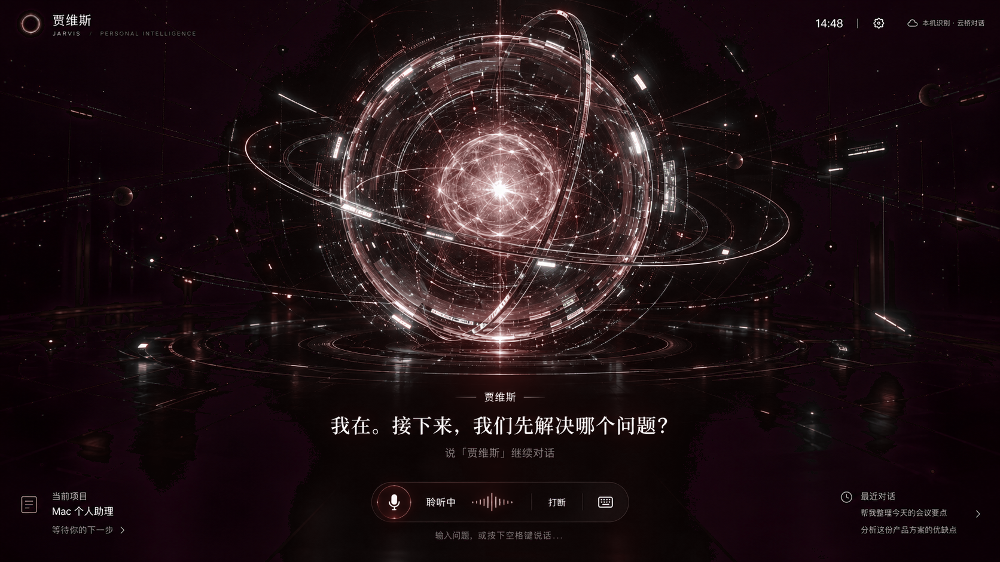

# Starcore Assistant · 星核助理

A personal AI assistant for macOS with local speech recognition, Codex integration, and WeChat notifications.

在 Mac 上叫醒助理、讨论问题，再把明确的开发要求交给原 Codex 聊天。本轮工作结束后，通过微信接收摘要；手机上的文字也可以继续投递到原聊天。

当前为 **0.6.6 源码预览版**。已在 Apple Silicon Mac 上使用和验证，不提供通用安装包。iPhone 独立客户端、小爱音箱与跨设备同步尚未实现。



上图为场景设计参考。客户端采用固定镜头的分层曲面投影、独立轨道与粒子运动，字幕和控件使用真实界面状态；它不是可任意环绕的完整三维模型。

## 功能

- **本地语音识别**：Qwen3 ASR GGUF，原始麦克风片段在内存中处理。
- **可修改名字与唤醒词**：默认“贾维斯”，唤醒后支持 45 秒连续对话。
- **模型分工**：云桥负责聊天；DeepSeek 只用于可选的口述校对，默认关闭；Fish Audio 或 Mac 系统声音负责播报。
- **聊天与历史**：完整记录在本机加密保存，支持分页、检索和近期上下文。
- **原 Codex 聊天交接**：点击“交给 Codex”或说“让 Codex”加要求，附带近期讨论，通过原聊天队列继续。
- **项目选择**：固定聊天或自动跟随最近一条已送达提醒。直接问“当前项目”由本地读取选择；日常讨论也带上当前项目名和聊天标题。
- **微信提醒与续写**：绑定 ClawBot、查询状态、收取回合结束摘要，并将手机文字交给最近提醒对应的原聊天。
- **动态界面**：球壳、核心、底盘、星球、流光分别运动；支持减少动态和静态回退。

## 环境要求

| 项目 | 要求 |
| --- | --- |
| macOS | 原生构建目标为 macOS 13；实际运行已验证 Apple Silicon 上的当前开发系统，其他系统版本仍需实测 |
| Node.js | 22.16.0 或更高，推荐 Node 24；依赖内置 SQLite API |
| Python | 3.11 或更高，安装器使用 tomllib |
| Xcode | 完整 Xcode，提供 Swift 编译器、actool 与 iconutil；先完成 Xcode 自身的首次启动设置 |
| Codex | 本机桌面版和可用的 codex 命令；当前适配曾在 0.165 验证，升级后需复核本地接口 |
| ASR 模型 | 自行准备兼容的 Qwen3 ASR 0.6B GGUF，不包含在仓库里 |
| 服务账号 | 普通聊天需要云桥密钥；Fish 和 DeepSeek 按需配置；微信需要扫码绑定和有效会话 |

构建使用本机架构，不生成 Universal Binary。Intel Mac、其他系统以及模型后端的实际兼容性没有在这里承诺。

## 获取源码与检查

```bash
git clone https://github.com/xumuyan/starcore-assistant.git
cd starcore-assistant
npm ci
npm test
```

最近一次本地完整检查为 109 项通过。测试使用临时数据与模拟服务，不要求真实密钥、麦克风或付费 API；这些测试不代替真实语音、微信送达和 Codex 版本兼容验收。

只构建并核验原生应用，暂不安装，也不改动 Codex 设置：

```bash
npm run build:mac:check
```

产物位于 `dist/星核助理.app`，使用本机临时签名，不是公证发行包。构建产物记录了本机 Node 和运行目录，不能直接作为别的电脑的通用安装包分发。

仅预览独立动态场景，不加载语音或聊天服务：

```bash
npm run build:scene
python3 -m http.server 8080 --bind 127.0.0.1 --directory dist/fixed-camera-study
```

然后打开 <http://127.0.0.1:8080/study.html>。预览中的聆听与输入用于状态演示，不代表正在进行真实语音对话。

## 安装到自己的 Mac

安装前先完成上述构建检查，并确认本机 Codex 已经初始化过配置。

```bash
npm run build:mac
```

此命令会：

1. 将源码和依赖复制到私有 `~/.codex-weixin-notifier/runtime/`。
2. 备份 Codex 配置，替换顶层 `notify`，保存并转发原有通知命令；验证其他 TOML 配置值保持不变。
3. 准备微信服务与桌面完成监听的 macOS LaunchAgent。
4. 编译、签名核验，并安装到 `~/Applications/星核助理.app`。

数据目录沿用早期“Codex 微信提醒”的名称，避免升级后丢失已有账号与配置。

`python3 client/build.py --ui-only` 只更新客户端，不更新 Node 运行副本。修改 `src/` 后，需要更新运行副本；不能只重建界面。

## 配置语音与聊天

1. 打开星核助理，在设置中选择本地 Qwen3 ASR GGUF 文件。默认路径会尝试本机 SpeakMore 的模型位置；没有该文件时手动选择。不会读取 SpeakMore 密钥。
2. 填入云桥 API Key 和该分组可用的聊天模型。当前接口固定为 `https://api.yunqiao.me/v1/responses`，不修改全局 Codex 登录或模型设置。
3. 按需配置 Fish API Key 与音色 ID，或使用 Mac 系统声音。免费模型的实际额度以服务方规则为准。
4. DeepSeek 润色默认关闭，开启后会使用对应服务额度。聊天失败不会自动改用 DeepSeek。
5. 开启语音并在 macOS 弹窗允许麦克风权限，随后说“贾维斯”或自定义唤醒词。
6. 左下角选择目标聊天，再点击“交给 Codex”或说“让 Codex”加具体开发要求。

点击“打断”或按 `⌘ .` 取消助理请求与播报。已投递给 Codex 的任务仍遵循原聊天设置。播放时暂停拾音，目前没有播放中的自由插话和完整声学回声消除。

## 绑定微信与手机续写

在客户端打开“绑定微信／重新绑定微信”，或运行：

```bash
npm run login
```

打开命令输出的本机登录页面，用微信扫描实时更新的二维码并确认。不要继续扫描聊天截图里的旧二维码。成功绑定后，在 ClawBot 发送“开启提醒”激活当前服务会话。

| 微信输入 | 用途 |
| --- | --- |
| 开启提醒、暂停 | 控制推送 |
| 状态、最新 | 查询队列与最近结果 |
| 当前项目 | 查询手机续写目标 |
| 关闭续写、开启续写 | 控制手机要求投递 |
| 其他普通文字 | 续写开启时，投递给最近一条已送达提醒对应的原聊天 |

只接受绑定账号主人的入站文字，不把文字直接当 shell 命令执行。目标在收到要求时固定；同一条消息去重，投递结果未知不自动重发。原聊天的权限和审批仍然生效。

本机已验证原聊天队列能触发原会话的新回合，不新建或 fork 聊天。手机输入到最终完成提醒的整条链路，需要使用自己的账号与项目验证。

电脑需要保持开机、联网且 Codex 桌面进程可用。服务重启后需要至少一条微信入站消息激活会话；扫码成功不等于已经验证主动推送。电脑睡眠、断网或微信会话过期时不能保证实时发送。

## 状态与运行边界

完成事件来自 Codex 通知入口以及本地桌面记录的只读监听，使用聊天和回合标识去重。首次监听从现有文件末尾建立基线，不集中补发历史。

“本轮已结束”不等于代码正确、测试通过或整个项目完成。接口返回发送成功，也不等于手机已读。发送结果未知时保留待查状态，不自动重试。

桌面监听读取当前版本的 `state_5.sqlite` 和新增 JSONL；原聊天投递使用本机 `thread/queue/add` 接口。这些属于当前版本适配，不能视为永久稳定的官方订阅接口。

打开客户端会检查并启动监听与微信服务。退出客户端停止语音，微信后台可以继续；要停止微信提醒，请使用客户端“停止监听”。Mac 睡眠或输入设备变化后，可能需要重新开启语音。

## 隐私与本地存储

密钥、设置和聊天正文使用 AES-256-GCM 加密，保存在私有 `~/.codex-weixin-notifier/assistant/`。本地随机 `master.key` 支持当前账户自动解密，目录权限 0700、密钥文件 0600。备份需要同时保留主密钥和加密数据。

这能避免直接读取数据文件获得明文，但不能阻止已经控制当前 Mac 账户的程序解密。微信 SDK 账号、提醒队列、微信手机续写记录及原 Codex 聊天遵循各自存储规则，不能把它们全部称为加密数据库。

数据发送范围：

- 未唤醒音频只在本机内存中识别，不上传或保存原始片段。
- 唤醒后的聊天文本、近期上下文，以及当前选择的项目名和聊天标题会交给云桥。
- 只有启用润色时，相关口述文字才交给 DeepSeek；使用 Fish 时，回复文本交给 Fish。
- 普通聊天最多附带 16 条、约 12000 字符的近期上下文；交给 Codex 最多附带 12 条、约 10000 字符的近期讨论。
- 微信发送项目名和截断的最终摘要，进行基础凭据遮盖；不能保证识别所有可能的敏感文本。

不要提交或分享私有运行目录、账号文件、数据库、日志、二维码和密钥。本仓库排除了本机验收截图、录像、构建产物和运行数据。

## 本地管理与恢复

```bash
npm run status
```

在本机查看服务、待发、已发及发送结果未知的数量。`npm start` 是前台运行入口，不要与已有后台发送进程同时使用。

恢复原通知入口时，先停止监听与微信服务，再把 Codex 配置中的顶层 `notify` 恢复为私有目录 `previous-notify.json` 保存的数组。备份的完整配置仅供参考，避免覆盖之后修改的其他配置。

应用和数据分别保存；回退应用时保留数据目录，不要单独删除 `master.key`。

## 代码结构

```text
client/                 Swift 宿主、原生音频、加密桥接
client/hud/             真实界面、设置、项目选择与历史
client/scene/           动态场景、共享模型和独立预览
client/assets/          场景与原生图标源素材
src/assistant-*.mjs     ASR、聊天、加密记忆与开发交接
src/desktop-watch.mjs   桌面完成记录只读监听
src/codex-runner.mjs    原聊天队列适配
src/cli.mjs             微信连接、提醒与手机输入
test/                  隔离自动检查和合成数据
docs/                  设计过程、阶段记录与开发文章
```

历史验收文档中的截图和录像路径指向本地证据，不随公开源码提交。它们记录对应版本当时的检查，不表示每轮都重新调用了付费服务。当前能力以本 README 与源码为准。

## 开发记录与后续计划

- [仓库规则](AGENTS.md)
- [实施计划与验收状态](PLAN.md)
- [逐次操作日志](operatelog.md)
- [从想法到实现的完整记录](docs/blog/星核助理从想法到实现的完整记录.md)
- [版本记录](CHANGELOG.md)
- [第三方依赖与许可说明](THIRD_PARTY_NOTICES.md)

后续方向：改善日常语音体验、iPhone 客户端、小爱音箱接入、跨设备任务状态，以及可分发安装包。以上未实现部分不属于当前版本交付能力。

参考：[SpeakMore](https://github.com/zephyr4123/speakmore)、[云桥](https://www.yunqiao.me/guide)、[Fish Audio](https://fish.audio/)、[weixin-agent-sdk](https://github.com/wong2/weixin-agent-sdk)。
